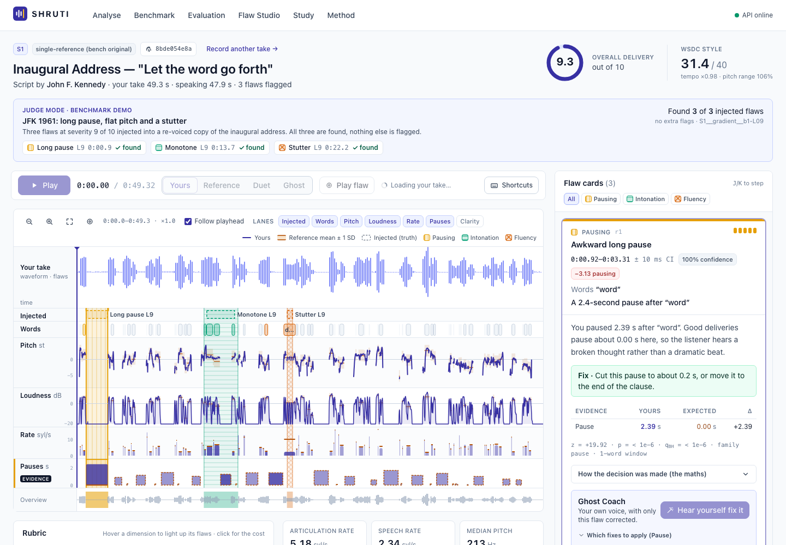
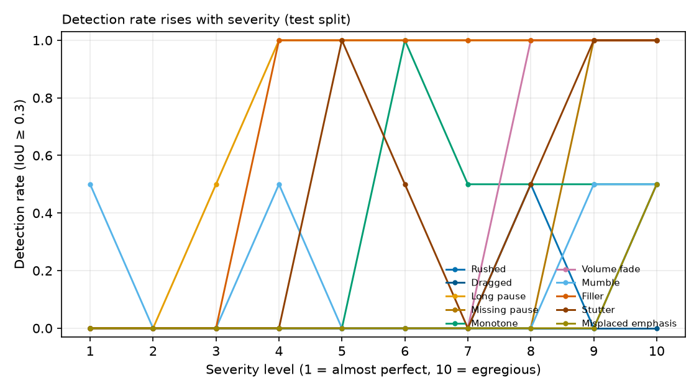
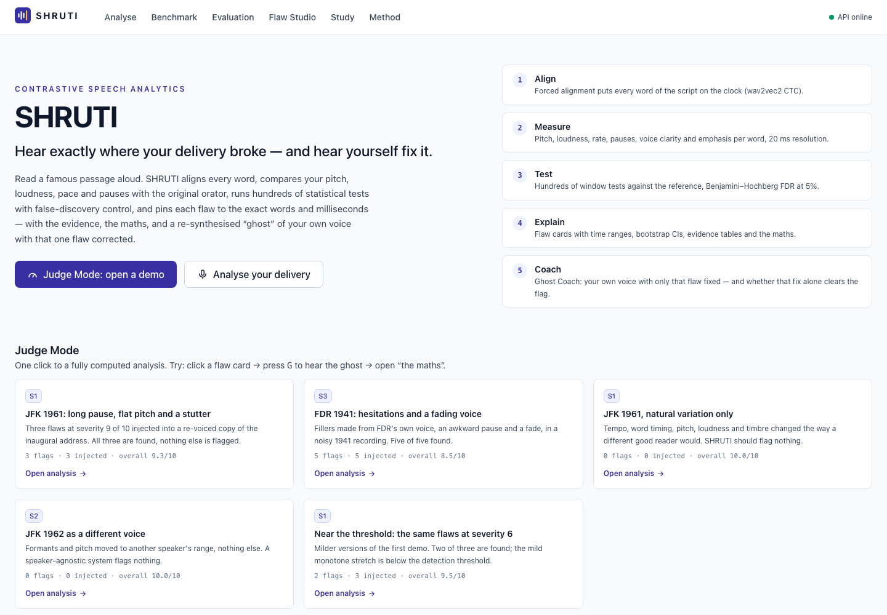
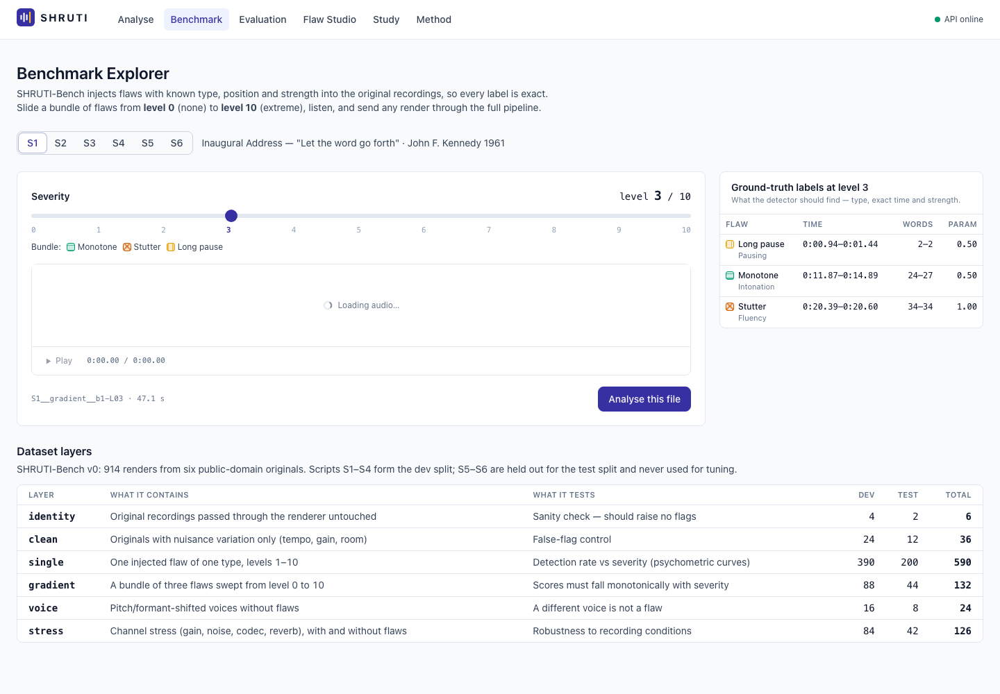
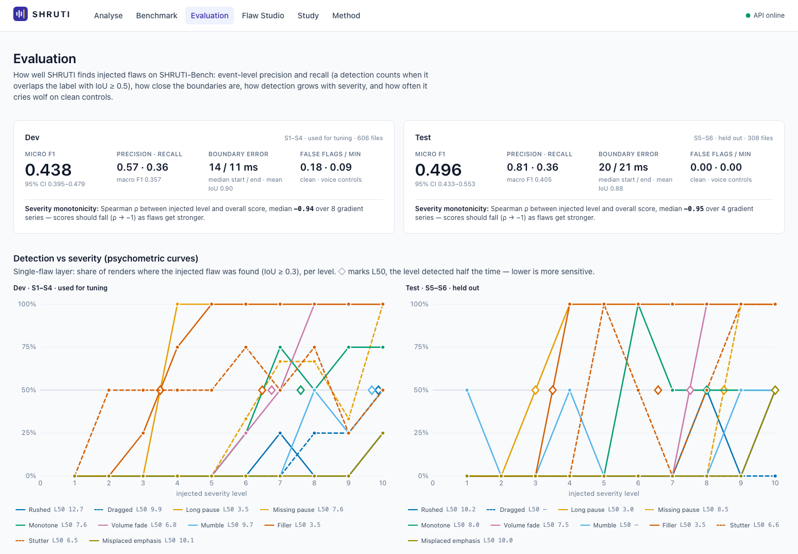
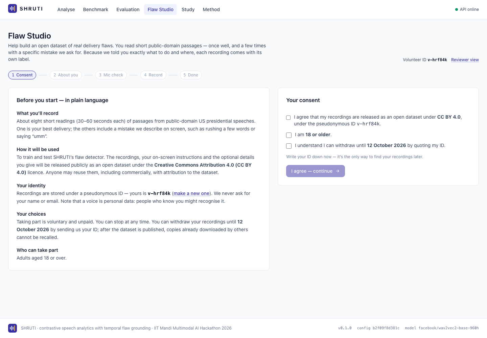

# SHRUTI — hear exactly where your delivery broke, and hear yourself fix it

**Track C · Contrastive Speech Analytics & Temporal Flaw Grounding · Multimodal AI Hackathon 2026 (IIT Mandi)**

SHRUTI compares a spoken delivery with good deliveries of the *same text*, word by word. It pins every delivery flaw to its exact start and end time, proves each flag with a statistical test under false-discovery-rate control, explains it with the numbers behind it, and plays back **the speaker's own voice with that one flaw corrected** (Ghost Coach).



| Held-out test (unseen speakers *and* texts, evaluated once) | |
|---|---|
| Event F1 at temporal IoU ≥ 0.5 | **0.50** (95% CI 0.43–0.55), precision **0.81** |
| Median boundary error | **20 ms** (start) / **21 ms** (end); mean IoU of matches 0.88 |
| False flags on flaw-free controls (clean, re-voiced, identity) | **0** in 16.6 minutes |
| Score vs injected severity (gradient series) | Spearman ρ = **−0.95** |

Links: **[demo video](TODO-youtube-link)** · **[hosted demo](TODO-hf-space-link)** · **[technical report](docs/REPORT.md)** · **[dataset datasheet](docs/DATASHEET.md)** · [model card](docs/MODEL_CARD.md) · [architecture](docs/ARCHITECTURE.md) · [AI-use disclosure](docs/AI_USAGE.md)

## Quick start

```bash
make setup          # Python 3.12 venv + pinned dependencies (needs uv, ffmpeg)
make web            # build the dashboard (Node 20+)
make serve          # http://127.0.0.1:8000  ->  Judge Mode works immediately
```

Or with Docker: `make docker` (API + dashboard on port 8000). Analyse a file from the command line:

```bash
.venv/bin/python -m shruti analyze my_take.wav --script S1
```

## What it does

1. **Align.** wav2vec2 CTC emissions and our own exact CTC Viterbi place every word (and character) of the script on the clock.
2. **Measure.** Every 10 ms: two-pass Praat pitch, intensity, harmonicity, 25 ms energy, spectral tilt and centroid (FFT), MFCC, and cepstral peak prominence (CPP). Per word: duration, pause after, pitch median/peak/range/slope in semitones relative to the speaker, loudness relative to the speaker, clarity and prominence. Silences are found globally with a noise-adaptive threshold; hesitations the aligner glued onto a word are split off.
3. **Judge.** About 450 hypotheses per minute-long take are tested against a **population baseline** (median of reference deliveries, spread shrunk toward a prior): tempo of 3-word windows and whole phrases, every pause, loudness drops, loss of brightness, pitch-range collapse, emphasis shifts, fillers and stutters. **Benjamini–Hochberg FDR control at q = 0.05** plus a practical floor in physical units decides what is flagged.
4. **Ground.** Flagged tests merge into regions with exact edges, a **bootstrap 95% interval** on each edge and a confidence score.
5. **Explain.** Deterministic cards: headline, explanation with the measured and expected values, fix, evidence table and a **math panel showing the actual test with its numbers**. No language model is used anywhere in scoring or explanation.
6. **Coach.** Ghost Coach re-delivers only the flagged region in the speaker's own voice (TD-PSOLA: timing, pauses with the recording's own room tone, reference pitch contour, loudness, cuts) and **re-analyses the corrected audio**. "Fixing the pause alone clears this flag" is a measured counterfactual, not a guess. Duet mode plays the original orator time-warped onto your timing. Drill mode lets you re-record one phrase and re-scores it in context.

The rubric scores seven dimensions (pacing, pausing, intonation, projection, fluency, clarity, emphasis) from 0 to 10 with `S_d = max(0, 10 − (60/T)·Σ c(severity) − g_d)`, so every lost point traces to a flaw card. It also gives a WSDC-style Style mark out of 40.

## SHRUTI-Bench: the contrastive dataset

No public dataset pairs good deliveries of a text with a graded spectrum of flawed deliveries of the same text. SHRUTI-Bench builds one ([datasheet](docs/DATASHEET.md)).

- **Good baselines:** six public-domain US presidential speech excerpts from Wikimedia Commons: JFK 1961 and 1962, FDR 1941, Obama 2009, Eisenhower 1961, Reagan 1987. Sources, licences and SHA-256 sums are in [`data/sources.csv`](data/sources.csv).
- **The bad mirror:** 10 flaw types × 10 severity levels, from "almost perfect" to egregious. All are made with signal processing in the speaker's own voice: fillers are built from the speaker's own vowels, and pauses are filled with the recording's own room tone.
- **Controls that must stay clean:** natural-variation renders (tempo, timing, pitch, loudness, timbre), re-voiced renders (a different "speaker"), and identity passes through the same processing chain.
- **Stress tests:** noise at 30, 20 and 10 dB SNR, telephone band, reverberation, MP3 at 64 kbps, and −12 dB gain.
- **Size:** 914 renders, 10.5 hours, 1,160 labelled flaw events with millisecond labels carried exactly through every edit. They ship as 413 KB of seeded recipes; `make dataset && make verify` regenerates the audio bit-for-bit (SHA-256 checked).
- **Human layer (Flaw Studio):** volunteers record the scripts while the app shows an instruction such as "rush these words". **The instruction is the label.** Alignment proposes the boundaries and a reviewer verifies them ([protocol](studio/protocol.md), [consent](studio/consent.md)). Accepted good takes join the population baseline automatically.

| Split | Scripts | Renders | Use |
|---|---|---|---|
| dev | S1–S4 (JFK ×2, FDR, Obama) | 606 | every design decision and threshold |
| test | S5–S6 (Eisenhower, Reagan) | 308 | evaluated once, with the frozen configuration `b2f09f8d381c132e` |

## Results

Full tables are in [`results/benchmark/tables_frozen.md`](results/benchmark/tables_frozen.md) and the figures are in [`results/benchmark/figures/`](results/benchmark/figures).

| Flaw (test split) | Precision | Recall | F1 | L50: severity level detected half the time |
|---|---|---|---|---|
| Filler | 0.93 | 0.83 | **0.88** | 3.5 |
| Long pause | 0.86 | 0.72 | **0.78** | 3.0 |
| Monotone | 1.00 | 0.29 | 0.45 | 8.0 |
| Stutter | 0.78 | 0.30 | 0.44 | 6.6 |
| Volume fade | 0.71 | 0.23 | 0.34 | 7.5 |
| Mumble | 0.33 | 0.20 | 0.25 | > 10 |
| Missing pause | 0.57 | 0.12 | 0.20 | 8.5 |
| Rushed | 0.60 | 0.11 | 0.19 | 10.2 |
| Misplaced emphasis | 1.00 | 0.06 | 0.11 | 10.0 |
| Dragged | 0.00 | 0.00 | – | > 10 |



**Reading the results honestly.** SHRUTI is built precision-first: when it flags something, it is real (test precision 0.81, zero false flags on 16.6 minutes of flaw-free controls). Pauses, fillers and stutters are found at mild severities and pinned to about 20 ms. Tempo, emphasis and mumbling are measured accurately (for example, the measured tempo ratio tracks the injected one), but they clear the FDR bar only at high severities. Their thresholds depend on how much good speakers naturally differ, which is a prior we refuse to fit to synthetic data. `python -m shruti priors` estimates it from Flaw Studio's human good takes.

Known issue (v1.1): the aligner can place a short function word inside a long pause, which clips the measured pause end. The fix is planned, not applied after the freeze, so the numbers above stay valid.

A contrastive delivery encoder (conv + BiGRU, margin contrastive loss plus a flaw-type head) is included as an ablation. On a held-out dev script it did not beat the statistics (F1 0.359 vs 0.363), so it ships disabled ([model card](docs/MODEL_CARD.md)).

## Dashboard

| | |
|---|---|
|  |  |
| **Judge Mode**: five pre-computed analyses, including two clean controls that must stay clean. | **Benchmark explorer**: slide one take from level 0 to 10 and hear and see the flaws appear. |
|  |  |
| **Evaluation**: dev and test metrics, psychometric curves, controls, robustness. | **Flaw Studio**: consent, instructed-flaw recording, review and verification. |

Keyboard: Space play · J/K previous/next flaw · G ghost · R reference · ? help.

## Reproducibility

```bash
make data          # download the six public-domain sources (SHA-256 checked)
make dataset       # regenerate all 914 renders from recipes
make verify        # check every render against its recorded SHA-256
make predict-dev predict-test eval   # every reported number, tables and figures
make test          # fast unit tests;  make test-all  adds integration + golden tests
```

- Dependencies are pinned in `requirements.lock` (Python 3.12) and `web/package-lock.json`.
- Inference runs on CPU; the bootstrap is seeded; no clock or random state enters a result.
- Each analysis carries a fingerprint: SHA-256 of the audio, the config hash, the model id, the code version and the reference ids.
- `tests/integration/test_pipeline.py` asserts that two analyses of the same audio produce byte-identical JSON.

## Repository layout

```
src/shruti/   align/ features/ baseline/ detect/ explain/ rubric/ coach/ inject/ stress/ dataset/ eval/ encoder/ studio/ api/
web/          React + TypeScript dashboard (Vite, Tailwind, wavesurfer.js, KaTeX)
data/         scripts.json, sources.csv, bench/ (originals, recipes, labels), demos/, study/
configs/      default.yaml  (every threshold and prior, with comments)
results/      benchmark/ (frozen metrics, tables, figures)
docs/         REPORT, DATASHEET, MODEL_CARD, ARCHITECTURE, AI_USAGE, img/
studio/       consent.md, protocol.md
tests/        unit/, integration/
```

## Licences and attributions

- **Code:** MIT.
- **SHRUTI-Bench recipes, labels and team or volunteer recordings:** CC BY 4.0.
- **Reference recordings:** works of the US federal government in the public domain (17 U.S.C. §105), obtained from Wikimedia Commons; file pages are listed in `data/sources.csv`. Manipulated renders of these speeches are synthetic and labelled as such, for delivery research only.
- **Alignment model:** wav2vec2-base-960h (Meta AI), Apache 2.0.

**AI assistance:** see [docs/AI_USAGE.md](docs/AI_USAGE.md). AI coding assistants were used and are disclosed there and in Devpost's *Built With*.
